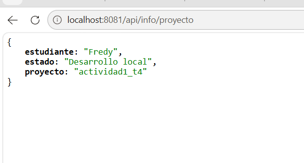
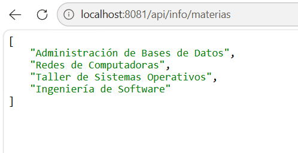

# Actividad 1 - Tema 4: Controladores Spring Boot

Proyecto base de Spring Boot con arquitectura REST desarrollado para atender peticiones HTTP mediante controladores web y desplegado en un servidor VPS.

## Tecnologías Utilizadas
- Java 21
- Spring Boot (Spring Web, DevTools)
- Apache Maven
- Servidor Ubuntu Linux (VPS)

## Endpoints Disponibles

### Controlador 1: `InfoController` (`/api/info`)
- `GET /api/info/proyecto`: Devuelve los metadatos del proyecto y del autor.
- `GET /api/info/materias`: Lista simulada de asignaturas.

### Controlador 2: `StatusController` (`/api/status`)
- `GET /api/status/servidor`: Proporciona la telemetría, estampa de tiempo y estado del servidor.

## Pruebas de manera local 

## Enlaces de Despliegue en VPS
- **Proyecto / Info:** `http://179.197.84.73:8081/api/info/proyecto`
- **Materias:** `http://179.197.84.73:8081/api/info/materias`
- **Estado del Servidor:** `http://179.197.84.73:8081/api/status/servidor`